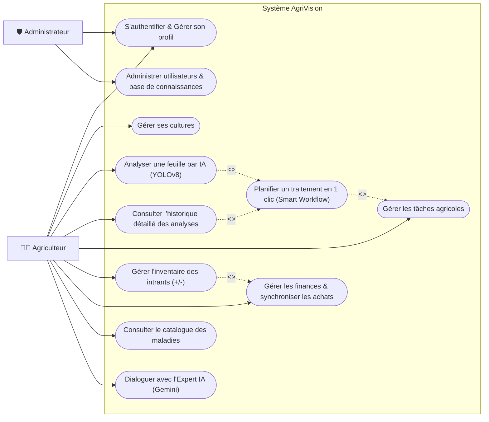
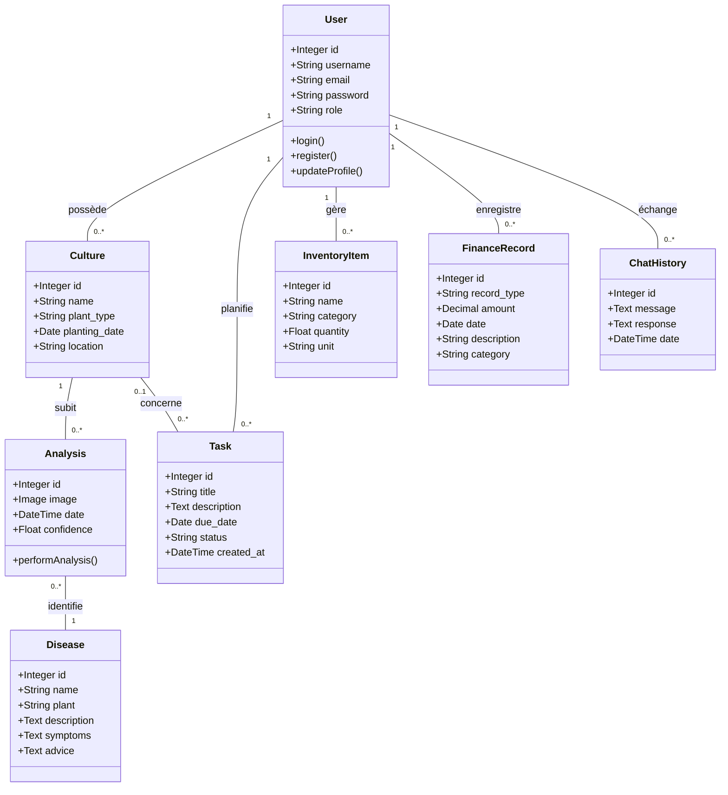
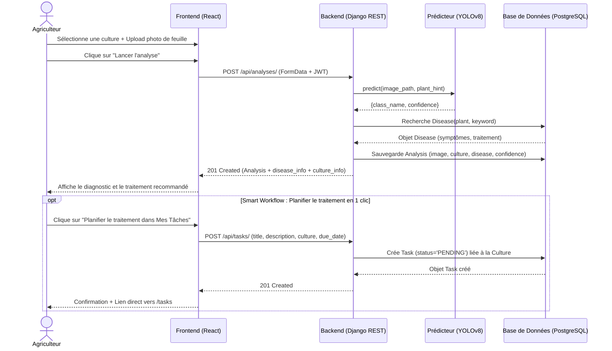
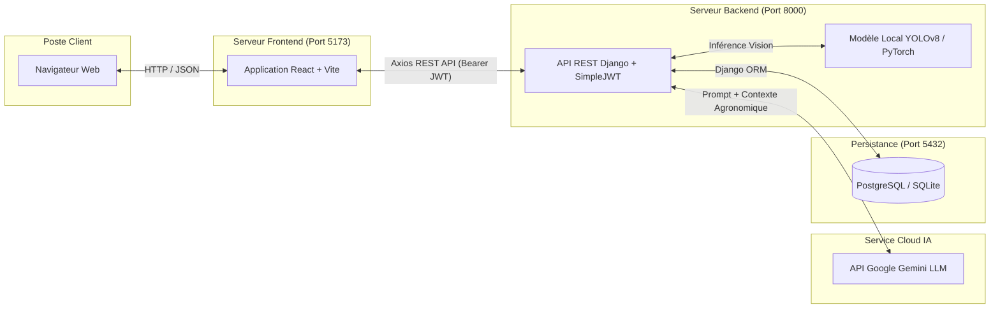

# Documentation Technique et Spécifications UML - AgriVision

## 1. Acteurs du Système
* **Agriculteur (Utilisateur Principal)** : Interagit avec l'application pour surveiller ses cultures, diagnostiquer des maladies via des photos de feuilles, consulter les traitements recommandés, dialoguer avec l'expert IA (Chatbot), et gérer son exploitation (tâches agricoles, inventaire des intrants, suivi financier et paramètres du compte).
* **Administrateur** : Supervise la plateforme, gère les utilisateurs et maintient le catalogue global des plantes et maladies (via l'interface d'administration Django).
* **Modèle Vision IA (Ultralytics YOLOv8)** : Module de vision par ordinateur intégré au backend recevant les images de feuilles et retournant la maladie détectée avec un score de confiance filtré par espèce végétale.
* **Assistant Agronome IA (Google Gemini)** : Grand modèle de langage (LLM) contextualisé avec la base de connaissances agronomiques d'AgriVision et l'historique de conversation de l'agriculteur.

---

## 2. Besoins Fonctionnels
1. **Gestion des Utilisateurs & Profil** : Inscription, connexion et déconnexion sécurisées par JWT (`SimpleJWT`), gestion des rôles (`AGRICULTEUR` / `ADMINISTRATEUR`), modification des informations du profil (`username`, `email`) et changement sécurisé du mot de passe.
2. **Gestion des Cultures** : Ajout, consultation et suppression des parcelles/cultures (nom du champ, type de plante parmi 14 espèces, date de plantation, localisation).
3. **Diagnostic IA des Maladies (YOLOv8)** : Téléversement d'une photo de feuille associée à une culture, prédiction intelligente filtrée par plante sur 38 classes PlantVillage, et affichage du diagnostic complet (symptômes, description, traitement recommandé).
4. **Catalogue des Maladies** : Consultation de l'encyclopédie répertoriant les 38 classes/maladies sur 14 espèces végétales, avec recherche et filtrage dynamique.
5. **Historique Détaillé des Analyses** : Sauvegarde et consultation des analyses précédentes avec miniature de la feuille analysée, badge de la culture associée, score de confiance, panneau de diagnostic détaillé et suppression.
6. **Chatbot Agronome IA avec Mémoire (`ChatHistory`)** : Assistant conversationnel propulsé par Google Gemini, enrichi par le catalogue des maladies et sauvegardant l'historique des échanges en base de données.
7. **Gestion des Tâches Agricoles (`Task`)** : Création, suivi d'avancement (`PENDING`, `IN_PROGRESS`, `COMPLETED`) et suppression de tâches liées aux cultures.
8. **Gestion de l'Inventaire (`InventoryItem`) & des Finances (`FinanceRecord`)** : Suivi des stocks d'intrants (engrais, pesticides, semences, équipement) avec ajustement rapide (`+`/`-`) et édition complète ; suivi de la trésorerie (revenus, dépenses et bilan net).
9. **Flux Intelligents Inter-Modules (*Smart Workflows*)** :
   * **Diagnostic IA → Tâche de Traitement en 1 clic** : Depuis un résultat d'analyse (page d'accueil ou historique), création automatique d'une tâche planifiée liée à la culture avec le traitement recommandé.
   * **Achat d'Inventaire → Dépense Financière automatique** : Lors de l'ajout ou de la mise à jour d'un stock d'intrant, enregistrement automatique optionnel de la dépense correspondante dans le module Finances.

---

## 3. Répartition des Modules (Architecture)
L'application suit une architecture **Client-Serveur (SPA React + API REST Django)** :
* **Module Frontend (React 19 / Vite)** : Interface utilisateur moderne en *Glassmorphism* comprenant les pages `Home`, `Login`, `Dashboard` (Cultures, Historique des Analyses, Paramètres), `Diseases`, `Tasks`, `Inventory`, `Finances` et le composant flottant `Chatbot`.
* **Module Backend (Django / Django REST Framework)** : Expose l'API RESTful sécurisée par JWT, orchestre la logique métier, les *Smart Workflows*, et assure la liaison entre le frontend, PostgreSQL et les modèles d'IA.
* **Module IA Hybride (YOLOv8 + Google Gemini)** :
  * **Vision (`ia/predictor.py`)** : Classification d'images sur 38 classes avec filtrage contextuel par plante (`plant_hint`).
  * **LLM (`ChatbotView`)** : Génération de conseils agronomiques personnalisés avec mémoire conversationnelle.
* **Module de Données (PostgreSQL)** : Persiste les 8 entités métier (`User`, `Culture`, `Disease`, `Analysis`, `ChatHistory`, `Task`, `InventoryItem`, `FinanceRecord`).

---

## 4. Diagrammes UML

### 4.1. Diagramme de Cas d'Utilisation
Ce diagramme illustre les interactions des acteurs avec l'ensemble des modules d'AgriVision.

### 4.2. Diagramme de Classes
Ce diagramme détaille les 8 entités métier de la base de données et leurs associations.

### 4.3. Diagramme de Séquence : Diagnostic IA & Planification Automatique de Traitement
Détaille le flux temporel lors d'un diagnostic d'image suivi de la création en 1 clic d'une tâche de traitement.

### 4.4. Diagramme d'Architecture / Déploiement
Montre comment les différents modules physiques et services d'IA communiquent entre eux.

