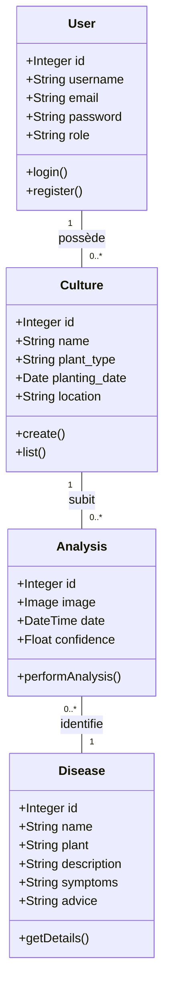
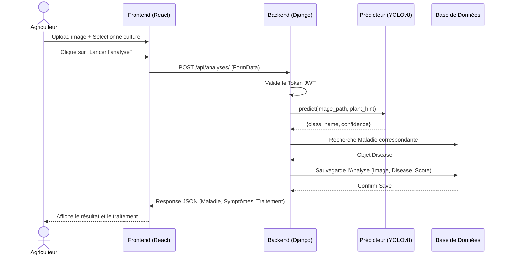
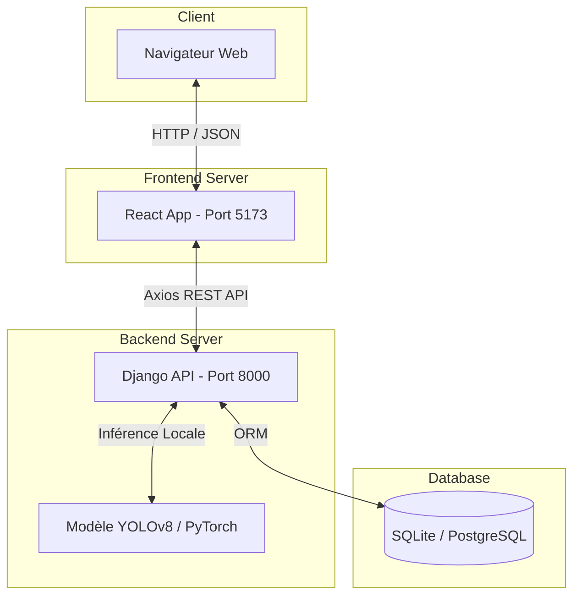

# Documentation Technique et Spécifications UML - AgriVision

## 1. Acteurs du Système
* **Agriculteur (Utilisateur Principal)** : Interagit avec l'application pour surveiller ses cultures, diagnostiquer des maladies via des photos, et consulter les traitements recommandés.
* **Administrateur** : Supervise le système, peut mettre à jour la base de données des maladies ou gérer les utilisateurs (via l'interface d'administration Django).
* **Modèle IA (Système Externe/Interne)** : Module intelligent (YOLOv8) recevant des images et retournant des prédictions de maladies.

---

## 2. Besoins Fonctionnels
1. **Gestion des Utilisateurs** : Inscription, connexion, et déconnexion sécurisées par JWT.
2. **Gestion des Cultures** : L'agriculteur doit pouvoir ajouter une nouvelle culture (nom, type de plante, date, localisation) et lister ses cultures existantes.
3. **Analyse de Maladies (Diagnostic IA)** : L'utilisateur doit pouvoir uploader une image de feuille malade, sélectionner la culture concernée, et recevoir un diagnostic précis filtré par plante.
4. **Catalogue des Maladies** : Consultation de l'encyclopédie répertoriant les 38 maladies supportées, avec leurs symptômes et traitements (recherche et filtrage).
5. **Historique des Analyses** : Sauvegarde et affichage des analyses précédentes avec leurs résultats et taux de confiance.

---

## 3. Répartition des Modules (Architecture)
L'application suit une architecture **Client-Serveur (Modèle Vue Contrôleur/API)** :
* **Module Frontend (React / Vite)** : Interface utilisateur (Pages Home, Login, Dashboard, Diseases). Gère la présentation et l'envoi des données via l'API REST.
* **Module Backend (Django / Django REST Framework)** : Gère la logique métier, la sécurité (JWT), et sert d'interface entre le frontend, la base de données et l'IA.
* **Module IA (Ultralytics YOLOv8)** : Intégré au backend, chargé d'analyser les tenseurs d'images et de classifier les maladies sur 38 classes PlantVillage.
* **Module de Données (Base de Données)** : Stocke les entités (Users, Cultures, Diseases, Analyses).

---

## 4. Diagrammes UML

### 4.1. Diagramme de Cas d'Utilisation
Ce diagramme illustre les interactions possibles des acteurs avec le système.

```mermaid
usecaseDiagram
    actor Agriculteur
    actor Admin
    
    package "Système AgriVision" {
        usecase "S'authentifier" as UC1
        usecase "Gérer ses cultures" as UC2
        usecase "Analyser une feuille (IA)" as UC3
        usecase "Consulter l'historique" as UC4
        usecase "Consulter le catalogue des maladies" as UC5
        usecase "Gérer la base de connaissances" as UC6
    }
    
    Agriculteur --> UC1
    Agriculteur --> UC2
    Agriculteur --> UC3
    Agriculteur --> UC4
    Agriculteur --> UC5
    
    Admin --> UC1
    Admin --> UC6
    
    UC3 ..> UC1 : include
    UC2 ..> UC1 : include
```

### 4.2. Diagramme de Classes
Ce diagramme détaille la structure de la base de données et les relations entre les entités métier.



### 4.3. Diagramme de Séquence : Analyse d'une image
Détaille le flux temporel et les échanges lors d'un diagnostic d'image par l'agriculteur.



### 4.4. Diagramme d'Architecture / Déploiement
Montre comment les différents modules physiques communiquent entre eux.


